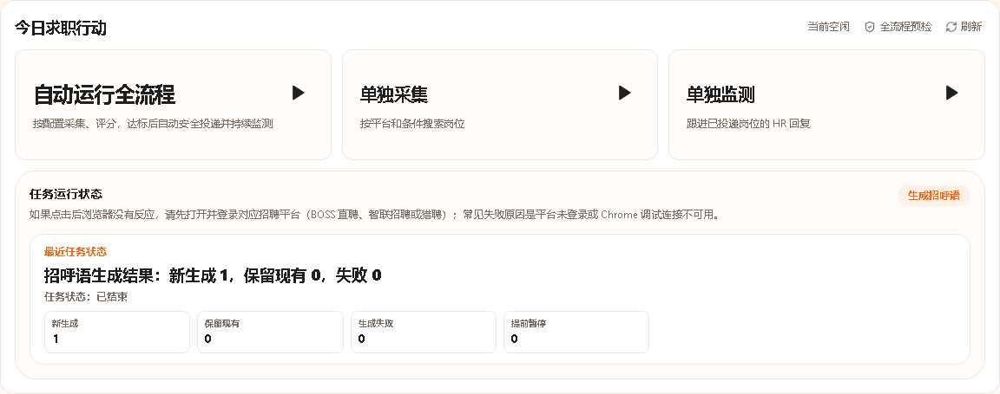
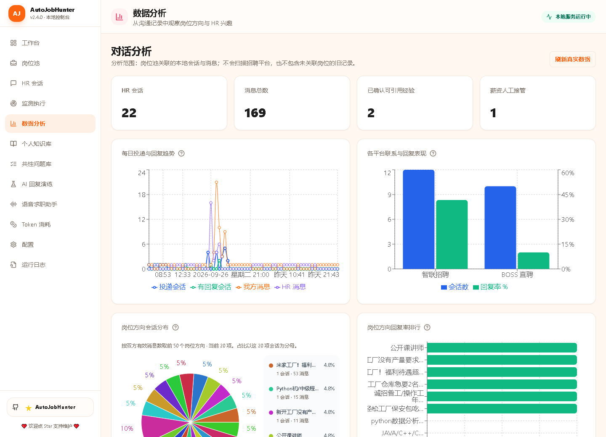
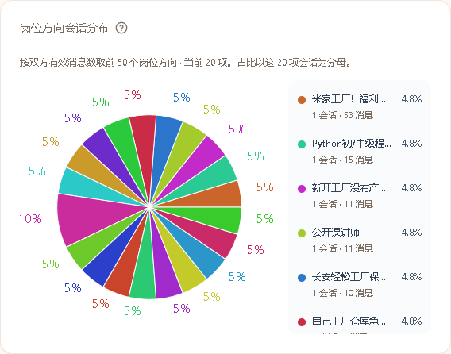

# AutoJobHunter

本地运行的多平台 AI 求职控制台：集中采集岗位、结合个人资料评分、低频投递、管理 HR 会话，并将符合策略的沟通交给 AI 自动处理。

当前软件版本：**v2.4.0**。版本一致性不等于双平台真实验收已全部完成。

项目仓库：[haoxuan454/AutoJobHunter](https://github.com/haoxuan454/AutoJobHunter) · [反馈问题](https://github.com/haoxuan454/AutoJobHunter/issues) · [许可证](LICENSE)

> 本文按 2026 年 10 月 10 日的当前代码整理。产品名称为 **AutoJobHunter**。为保留兼容性，Python 包、命令行与部分目录暂时仍使用 `bosshunter`；这不是另一个需要安装的项目。
>
> 自动化操作存在账号限制、误操作和隐私风险，低频也不能保证绝对安全。本项目不隶属于任何招聘平台，不绕过验证码或登录验证。请遵守平台规则，仅在本人明确授权的账号上使用。

## 目录

- [项目定位与当前状态](#项目定位与当前状态)
- [功能与平台边界](#功能与平台边界)
- [界面预览](#界面预览)
- [安装与启动](#安装与启动)
- [首次配置](#首次配置)
- [自动运行全流程](#自动运行全流程)
- [保留的手动工作流](#保留的手动工作流)
- [HR 会话中心](#hr-会话中心)
- [数据分析怎么看](#数据分析怎么看)
- [日志与故障处理](#日志与故障处理)
- [项目架构与数据隔离](#项目架构与数据隔离)
- [开发与验证](#开发与验证)
- [隐私安全与发布检查](#隐私安全与发布检查)
- [来源与许可证](#来源与许可证)

## 项目定位与当前状态

AutoJobHunter 将分散在招聘平台上的岗位和聊天记录归集到本地控制台，减少重复搜索、筛选和整理资料的工作。可以选择手动审核，也可以明确启动自动任务。

```text
选择 BOSS / 智联及搜索条件
  → 平台分别采集 → 本地岗位池 → 真实资料 AI 评分
  → 筛选本轮达标岗位 → 平台队列低频投递 → 验证送达
  → 补齐本地 HR 会话 → 持续轮询本轮已验证会话
  → HR 新消息 → 策略检查
       ├─ 用户已关闭：跳过
       ├─ 敏感事项：暂停、通知人工
       └─ 允许自动处理：资料检索 → AI 回复 → 验证送达
```

**当前不能把这条链路宣传为“双平台真实全量验收全部通过”。** 双平台已有真实采集、评分和首次投递样本；聊天页生命周期、BOSS 目标安全选择与姓名提取已修复，两平台样本连续两轮真实只读同步均无失败。但最新服务入口的整链复验、各平台 2～3 个样本以及真实 HR 新消息触发 AI 回发的送达证据尚不齐全。以 [低频验收记录](docs/acceptance-2026-10-10.md) 为准，代码支持不等于平台真实通过。

自动运行是显式授权模式，不是后台默认发送。旧 `full` 工作台模式已禁用，首页统一使用 `auto_full`（“自动运行全流程”）；手动采集、评分、投递与编辑回复仍可单独使用。

## 功能与平台边界

### 核心功能

| 功能 | 当前行为 |
| --- | --- |
| 多平台采集 | 关键词、城市、页数、排序及平台筛选；保存来源、详情和断点 |
| 岗位池 | 去重、筛选、评分、投递状态、招呼语准备、详情和删除/回收 |
| AI 评分 | 基于岗位 JD、简历与配置；不伪造分数凑投递样本 |
| 自动任务 | BOSS/智联独立采集、并行推进；本轮达标岗位进入平台队列 |
| 平台发送 | 同平台串行，随机间隔、额度及风险停止 |
| HR 会话 | 真实聊天同步、未读红点、全局排序、分页、草稿与人工发送 |
| 自动会话控制 | 单卡停用；敏感话题暂停并交给人工 |
| 个人知识库 | 上传资料、整理经验事实；引用已确认可公开的信息 |
| 对话分析 | 本地真实趋势、平台表现、岗位方向、高频问题图表 |
| 运行日志 | 已接入的 HTTP、任务、采集/发送事件，检索与分页 |
| 积压管理 | 三个面板固定高度滚动，单删/批删/全选删除 |
| 辅助工具 | AI 回复演练、共性问题库、Token 消耗、语音求职助手 |

### 平台支持范围

| 平台 | 采集/评分 | 平台发送 | 自动全流程 | HR 会话同步 |
| --- | --- | --- | --- | --- |
| BOSS 直聘 | 支持 | 支持，需安全验证 | 已实现，真实末端验收未完成 | 支持，需识别具体 HR |
| 智联招聘 | 支持 | 支持，首次用平台默认招呼 | 已实现，真实末端验收未完成 | 支持，需识别具体 HR |
| 前程无忧 51job | 支持采集及 AI 处理 | 真实发送锁定 | 不纳入 | 不纳入 |
| 猎聘 | 支持采集及 AI 处理 | 真实发送锁定 | 不纳入 | 不纳入 |

不支持的功能不会因批量运行自动解锁。遇到验证码、登录失效、身份歧义或送达不明确，应停止对应操作，不做盲目重试。

## 界面预览

图片来自本地运行界面，不是概念效果图。统计仅为拍摄时的数据，不代表每个账号都已有这些记录。

### 工作台任务入口



### 本地对话分析



### 岗位方向与回复表现



## 安装与启动

### 环境要求

| 环境 | 要求/用途 |
| --- | --- |
| Python | 3.10+；后端、SQLite、AI 与业务流程 |
| Node.js | 项目指南使用 22+；前端构建与 Browser Runtime |
| Google Chrome | 可连接的远程调试会话；在该会话内登录平台 |
| AI 服务 | 有效 API、模型与凭据；真实评分和生成回复必需 |

### Windows / PowerShell

```powershell
 git clone https://github.com/haoxuan454/AutoJobHunter.git
 Set-Location AutoJobHunter
 py -3 -m venv .venv
 .\.venv\Scripts\python.exe -m pip install --upgrade pip
 # dist 不在 Git 中，首次安装先构建前端。
 npm --prefix src/bosshunter/web/frontend ci
 npm --prefix src/bosshunter/web/frontend run build
 .\.venv\Scripts\python.exe -m pip install -e .
 .\.venv\Scripts\bosshunter.exe web --no-open
```

打开 `http://127.0.0.1:8686/`。已有仓库直接在项目根操作，不需再次克隆。若 `py` 不在 PATH，使用实际 Python 路径；已有虚拟环境不要重新创建或删除。

### macOS / Linux

```bash
 git clone https://github.com/haoxuan454/AutoJobHunter.git
 cd AutoJobHunter
 python3 -m venv .venv
 source .venv/bin/activate
 npm --prefix src/bosshunter/web/frontend ci
 npm --prefix src/bosshunter/web/frontend run build
 python -m pip install -e .
 bosshunter web --no-open
```

安装命令不代表当前版本已在所有系统做过真实平台验收。备用 PDF 渲染可选安装 `python -m pip install -e '.[pdf]'`。

### Chrome 连接与登录

Browser Runtime 连接开启远程调试的 Chrome，不继承其他窗口的账号。可使用独立用户目录启动：

```text
chrome.exe --remote-debugging-port=9222 --user-data-dir="C:\AutoJobHunterChrome"
```

按实际 Chrome 安装位置和独立目录调整。在该窗口登录 BOSS/智联并保持开启。不要向公网暴露调试端口，也不要覆盖已有 Chrome 用户目录。

```powershell
.\.venv\Scripts\bosshunter.exe connect
.\.venv\Scripts\bosshunter.exe ai-status
```

`connect` 检查 Runtime/Chrome，不能证明平台已登录；`ai-status` 检查 AI，不显示完整密钥。搜索页和聊天页仍需分别核验。

## 首次配置

入口：`/config`。也可复制 [配置模板](config.example.yaml) 为本地 `config.yaml` 后调整；模板中含历史字段说明，不应直接当作自动任务已启用的证明。

### 简历与个人资料

- 上传自己的简历，支持 `.md`、`.docx`、`.pdf`。PDF 提取质量需要本人检查，扫描件不保证直接识别。
- 设置目标岗位、城市、薪资范围、学历、校招/社招、屏蔽公司和排除条件。
- 个人知识库支持 `.md`、`.txt`、`.docx`、`.xlsx`、`.pdf`，用于补充经验材料。
- 确认可公开引用的经验事实，不应将身份证、银行卡、密码等放入可公开事实。

AI 不应补全不存在的项目、工作年限、电话或薪资承诺。上传资料不意味着允许将原文件自动发给 HR。

### AI 服务

配置服务、Base URL、模型、密钥、超时和任务参数。OpenAI 兼容分支请求配置地址下的 `/chat/completions`；是否包含 `/v1` 按实际服务接口填写，不能把网页地址当 API。

当前验收指定 `https://api.deepseek.com/v1` 与 `deepseek-flash`。保持已确认配置，不偷偷换模型；服务是否接受模型名，以实际诊断结果为准。

密钥通过本地界面填写，凭据保存在忽略提交的本地文件中，不要写进 README、截图、Issue 或 Git。

### 搜索与自动投递参数

自动任务弹窗可选择 BOSS/智联，分别设置关键词、城市、最大页数、排序和筛选；同时设置：

| 参数 | 作用 |
| --- | --- |
| 最低评分 | 本轮评分达到或超过阈值才可投递 |
| 每平台最大投递数 | 当前限制每平台 1～3 个，不是无限量发送 |
| 随机等待上下限 | 平台内逐条等待；真实验收建议 60～180 秒，不关闭安全节流 |
| BOSS 统一招呼语 | 自动首次投递使用明确填写的话术，不必先逐岗个性化生成 |
| 智联首次招呼 | 使用平台默认流程，不套用 BOSS 话术 |

还可设置每日额度、发送窗口、采集冷却与风险暂停。达标不等于立即发送：状态、平台身份、额度和时间也参与约束。

### QQ 邮箱与人工接管

配置 SMTP、授权凭据、收件地址、启用与自动发送。QQ 邮箱使用 SMTP 授权方式，授权码不能公开。

策略识别薪资、面试、Offer、微信等事项；配置和识别结果决定暂停/通知。先用本地演练核对分类再开启真实发送。进入 outbox、SMTP 接受与真实到达收件箱是不同的验收层次。

## 自动运行全流程

入口：工作台 `/` 的“自动运行全流程”。同一个任务贯穿采集、评分、投递、会话补建和监测，不是投递完即宣告全部自动化结束。

| 阶段 | 职责 | 安全边界 |
| --- | --- | --- |
| 预检 | 配置、平台能力、AI 与浏览器检查 | 预检不代替页面送达证据 |
| 采集 | 各平台按本轮条件入库 | 平台间可并行，各自遵循节流和断点 |
| 评分 | 本轮匹配范围内需要评分的岗位 | 不将整个历史岗位池全部投递 |
| 筛选 | 达标可投递岗位按分数优先、遵守上限 | 分数不能绕过状态和身份校验 |
| 投递 | 各平台独立队列，同平台逐条 | 随机等待、额度、幂等认领、风险停止 |
| 补建 | 安全送达的岗位映射本地会话 | 仅点击过不能算成功 |
| 监测 | 轮询本轮已验证投递会话 | 不接管旧账号全部历史会话 |
| 回复 | 当前会话上下文与允许引用的资料 | 关闭/暂停/敏感策略优先；结果不明不自动重发 |

跨平台并行不等于同平台同时发多条。网页聊天是有状态的：确认目标后才能读取或发送，不能并发切换同一页面导致串聊。

### 监测循环与停止

每轮只处理本轮安全投递范围内的会话，逐个同步、检查新 HR 消息、决定是否回复，然后等待下一轮。轮询间隔由 `monitor.interval` 配置，默认 30 分钟；`collection.collection_delay_multiplier` 仅用于页面操作节流，不再把 30 分钟轮询静默放大为 45 分钟。此修复需后端重新加载后生效；轮询间隔不取代各平台发送间隔。

持续监测不是每秒抓取，也不是实时推送。用户停止、后端退出、账号失效或身份不明都会影响循环。任务状态在后端内存，重启后不能假定原任务自动恢复。

同一任务内，AI 服务临时失败后会保留尚未回答的 HR 问题，下一轮继续处理；用户已经手动回答或进入人工接管时会清除该待处理项。待处理项仍在内存，不等于进程重启后的自动恢复。

自动回复先等待、再核本地状态、再安全选中目标并核平台快照。生成期间出现新 HR 消息或用户手动回复时，撤销陈旧草稿而不是强行发送。只有已确认没有开始发送的尝试可以重新生成；结果不明或已送达不自动重试，手动发送的原有幂等规则保留。

单卡关闭自动链路后，后续轮询应跳过；敏感话题暂停后需人工确认恢复。AI 演练与真实平台记录分开，不能把演练当送达。

### 为什么还有积压面板

发送失败、待发送、待确认也可能是历史手动记录、异常或旧账号数据。自动任务不无条件发送全部历史积压；本轮达标且安全的自动岗位不需逐个再次确认。

异常保留用于追溯，不是伪装成功。三个面板固定高度滚动，支持单删、批删和全选删除；删除本地记录不撤回已发平台消息。

### 当前真实验收缺口

详细证据见 [验收记录](docs/acceptance-2026-10-10.md)：

| 项目 | 当前证据/后续条件 |
| --- | --- |
| BOSS 姓名与目标选择 | 已修上游标签污染、唯一列表行选择及正文加载校验；真实样本正确识别“陈维”并读取原生消息 ID/时间 |
| 聊天页生命周期 | 任务负责创建/保留自己的聊天页，仅结束时清理；两平台样本连续两轮真实同步无失败，未启用自动发送 |
| 智联首次送达 | 真实目标页面确认默认招呼及 HR 回复，补齐原先缺失的平台证据；拒绝回复不用于强行凑自动回发测试 |
| 自动发送前快照 | 自动回复重新选中目标后再次核对平台消息；AI 生成期间出现新消息/手动回复则撤销陈旧草稿，不向错误上下文发送 |
| 最新入口完整复验 | 当前 8686 旧进程尚未重载本轮修改；正常重启被工具执行策略阻断，独立进程取证不替代首页任务入口验收 |
| 完整规模与 AI 回发 | 每平台 2～3 个样本及合适的真实 HR 新消息触发自动回发仍待完成；不能改库制造通过或向拒绝岗位补发测试 |
| 历史消息双表示 | BOSS 历史合成发送记录与后来读取的原生记录可能同文共存；不能按文本粗暴删除或破坏幂等键，安全归并仍待验证 |

发送结果不明时不得反复重试。验收记录保留每轮失败原因、修复、复验结果及缺失的证据，不用删除失败记录的方式制造“全绿”。

## 保留的手动工作流

```text
采集 → 岗位池筛选/评分 → 选择岗位 → 审核投递或招呼语
     → 安全发送 → 会话同步 → 编辑草稿 → 确认发送
```

自动流修复不应破坏此流程。可按当前 HR 对话与个人资料生成草稿，再查看、编辑后发送。草稿不是已送达消息，历史草稿可以删除；手动发送仍需目标身份和送达验证。

CLI 历史流程与首页 `auto_full` 不能混用来证明验收。诊断可用 `bosshunter --help`、`connect`、`ai-status`；自动链路真实验收从首页任务入口启动。

## HR 会话中心

入口 `/conversations`；详情 `/conversations/:id`。

- **分页**：默认 12 张，支持 24/48、首页、前后页和尾页。
- **全局排序**：先排序全部再分页。第 5 页有最近新消息，应升到第 1 页，不只在原页排序。
- **最近活跃**：使用最新消息时间，跨时区统一比较。同步/尝试时间不是聊天活跃时间，重读旧记录不置顶。
- **自选排序**：最近活跃、对话最频繁、创建时间，作用于全量集合。
- **预览与红点**：最新已保存消息用于预览，新增 HR 内容触发红点；查看详情清除，下一次新内容再提示。
- **同步**：全量按钮复用单卡逻辑，只处理可安全确认的 BOSS/智联会话，失败应明确原因。
- **聊天**：历史在上、最新在下，进入默认定位最新，向上查看历史。
- **时间**：用户展示统一 `Asia/Shanghai` 北京/上海时间；存储仍可 UTC/ISO，不直接展示 `+00:00`。
- **链接**：有真实可用地址才提供；通用收件箱不是 HR 专属链接，不伪造。
- **自动控制**：单卡停用/恢复；状态策略与开关同时约束下一轮。

当前为 API 全量排序、前端分页，不是数据库分页。超大规模仍有传输及逐会话读取的性能边界。

## 数据分析怎么看

入口 `/analytics`。刷新真实本地数据库，不为画图发平台请求。仅统计岗位池关联会话，不是平台所有岗位数据。

| 图表/面板 | 可以看什么 | 不能据此断言什么 |
| --- | --- | --- |
| 每日投递与回复趋势 | 按日投递、首次回复会话和双方消息数 | 不是预测；历史时间不完整会影响口径 |
| 各平台联系与回复表现 | 会话样本和至少收到一条 HR 消息的比例 | 小样本不能判断平台优劣 |
| 岗位方向会话分布 | 双方有效消息量最多前 50 方向，其中会话占比 | 不是全市场岗位占比或回复率 |
| 岗位方向回复率排行 | 哪些方向更常收到回复，并查看样本量 | 不是录用率或薪资承诺 |
| 会话状态 | 活跃、等待、暂停等工作量 | 不是任务是否成功 |
| 消息角色 | 我方、HR、草稿、系统提示的构成 | 草稿/系统提示不是 HR 回复 |
| HR 高频问题/原话 | 按频次排序、固定区域滚动，辅助准备回答 | 同一句多次不等于多个 HR 都提问 |

标题旁 `?` 提供说明。饼图图例在面板内滚动、长名称省略，悬停扇区查看完整名称和数据。若历史记录只有相对时间或文本日期，趋势解释应结合实际数据质量，不把它当严格预测。

## 日志与故障处理

入口 `/logs`，侧栏“配置”之后。最新优先、搜索与分页，展示已接入的 HTTP、任务和业务日志；不是所有第三方进程输出天然都能捕获。

| 症状 | 核对与处理 |
| --- | --- |
| `platform conversation could not be selected safely` | 核 HR、公司、岗位、平台标识与账号；不要启用宽泛模糊匹配向猜测对象发送 |
| `not_loaded` | 核聊天页、目标打开和生命周期；不要反复发消息 |
| `send_not_verified` / `send_unknown` | 只读核平台实际消息，不自动重发，防已送达但确认丢失 |
| AI 超时/网络错误 | 检查 AI 诊断、URL/模型/超时/服务；保留完成状态，不伪造评分 |
| 搜索无新增 | 检查过滤、去重、断点 TTL 和搜索组合；不等于未登录，不随意清断点 |
| Chrome 登录但任务说未登录 | 核是否同一可调试窗口、是否混选搜索/IM 页；不输出 Cookies |
| 排序/红点异常 | 核真实新增 HR 消息与时间；同步时间不应充当活跃时间 |
| 改代码未生效 | 重建前端 dist，核后端工作目录及服务引用的产物 |

排错记任务 ID、阶段、非敏感标识、错误码、根因、修复和复验，避免反复同一试错。不公开认证头、Cookies 或完整资料。

## 项目架构与数据隔离

```text
AutoJobHunter/
├─ README.md / config.example.yaml / pyproject.toml
├─ src/bosshunter/
│  ├─ main.py / config.py         CLI、配置与凭据
│  ├─ collection/               平台采集、筛选、断点
│  ├─ automation/               编排、范围、评分、队列、配额、监测策略
│  ├─ executor/                 已有发送与监测执行器
│  ├─ platform_delivery/        平台投递和回复适配
│  ├─ browser/                  Chrome/CDP Runtime
│  ├─ ai/                       AI 评分、生成与服务调用
│  ├─ conversations.py          会话/消息仓库
│  ├─ conversation_ordering.py   活跃时间归一与排序
│  ├─ conversation_bridge.py     投递映射本地会话
│  ├─ conversation_analytics.py  本地统计
│  ├─ knowledge.py              知识文件与经验事实
│  ├─ notification_service.py   策略/邮件
│  └─ web/
│     ├─ server.py / tasks.py    Bottle API、工作台任务
│     ├─ runtime_logging.py     日志接入
│     └─ frontend/              React、TypeScript、Vite、Recharts
├─ tests/                       Python 测试及 browser 验证说明
├─ docs/                        文档、截图、验收证据
└─ data/                        本地库、资料、运行记录，不进 Git
```

自动模块复用已有采集/发送/会话仓库，将本轮范围、授权和策略分开，不复制互相漂移的发送器，不让自动授权改变手动默认策略。

### 隔离的关键

**不是每个平台、每个 HR 一张表。** 共享 SQLite 的会话/消息表通过平台、岗位 ID、本地会话 ID、平台会话标识及关联区分数据。

1. 只监测本轮已安全验证并补建的投递，不接管旧账号全部记录。
2. 只读当前会话上下文，不能用 A 的消息回复 B。
3. 页面身份可信；多个候选或多个本地卡片争用同一会话时拒绝发送。
4. 本地 `sent`、任务 `succeeded` 与实际送达分开，结果不明停止。
5. 换平台账号后历史卡片不能视为新账号会话。当前不能据文档保证完整账号级隔离已验收，必须重新核身份与范围。

### 页面与 API

| 页面 | 用途 |
| --- | --- |
| `/`、`/jobs`、`/monitor` | 工作台、岗位池、监测执行 |
| `/conversations`、`/conversations/:id` | 卡片与聊天详情 |
| `/analytics`、`/ai-usage` | 本地分析与 AI 用量 |
| `/knowledge`、`/common-questions` | 个人资料与问题库 |
| `/assistant-lab`、`/voice-assistant` | 回复演练、语音助手 |
| `/config`、`/logs` | 配置与运行日志 |

开发常用：`GET /api/health`、`GET /api/workbench`、`POST /api/workbench/task`、`POST /api/workbench/task/:id/stop`、`GET /api/conversations`、`GET /api/conversations/analytics`、`GET /api/logs`。任务/发送 POST 有副作用，不是只读探针；服务不应直接向公网暴露。

## 开发与验证

```powershell
# pytest 是开发依赖；其他插件按实际测试环境准备。
.\.venv\Scripts\python.exe -m pip install pytest
.\.venv\Scripts\python.exe -m pytest tests/test_conversations.py tests/test_conversation_bridge.py -q
npm --prefix src/bosshunter/web/frontend run test
npm --prefix src/bosshunter/web/frontend run build
# 全量耗时较长，按实际结果报告，勿把重叠分组相加。
.\.venv\Scripts\python.exe -m pytest -q
```

离线测试不得擅自发真实消息。真实验收先各平台一个低风险样本，证明后再扩到各 2～3 个，不改库制造达标。

2026-10-10 本轮回归：Python 全量 **1460 passed / 111 subtests passed**；前端 **14 个文件 / 46 项测试通过**，TypeScript 检查与生产构建通过。它们证明代码回归，不替代下述真实平台五层验收；原有失败及修复过程保留在验收记录中。

| 证据层 | 必须核对 |
| --- | --- |
| 平台页面 | 正确 HR 的实际消息与请求内容一致 |
| SQLite | 正确岗位/会话/消息关联，无串聊/重复 |
| API | 状态、范围、错误及停止原因与库一致 |
| 运行日志 | 采集到监测/回发阶段可追溯 |
| Web UI | 当前产物、卡片资料、排序、红点、分页和聊天正确 |

还需测试卡片停用跳过、敏感暂停、账号变更、取消/恢复及手动流程不回归。**没有真实 HR 新消息时，自动回发只能记“未获真实触发”，不能宣称通过或编造消息。**

## 隐私安全与发布检查

本地运行不意味着资料绝不外发：启用云端 AI 后，所需简历/JD/上下文可能发送到该服务；启用邮件也会发送通知。评估资料范围和第三方政策。

不要提交：`config.yaml`、`.*.credentials.yaml`、API Key、邮箱授权码、Chrome profile、Cookies、认证头、`data/` 数据库/日志/资料、敏感截图或 HAR、`.venv/`、`node_modules/`、`.codex-backups/`。

`.gitignore` 不代替检查已跟踪文件。发布前查看 `git status --short` 和待提交 diff。修改前备份目标文件，避免复制整仓库生成大量父级备份。README 更新不表示已向 GitHub 提交/推送。

## 来源与许可证

AutoJobHunter 在历史 BossHunter 基础上演进，保留内部包名及兼容入口。产品与当前流程以本 README 为准；旧指南中智联“仅手动投递”和历史 `full` 表述不是当前依据。

保留 [PolyForm Noncommercial License 1.0.0](LICENSE)，不是无条件商业许可；更名不改变许可证与来源义务。历史来源：[shengjidaguai-china/BossHunter](https://github.com/shengjidaguai-china/BossHunter)，原有贡献/治理记录保留在仓库。

修复及真实验收见 [验收记录](docs/acceptance-2026-10-10.md)；本地交接见 [交接文档](交接.md)，分享前检查运行信息及隐私。
